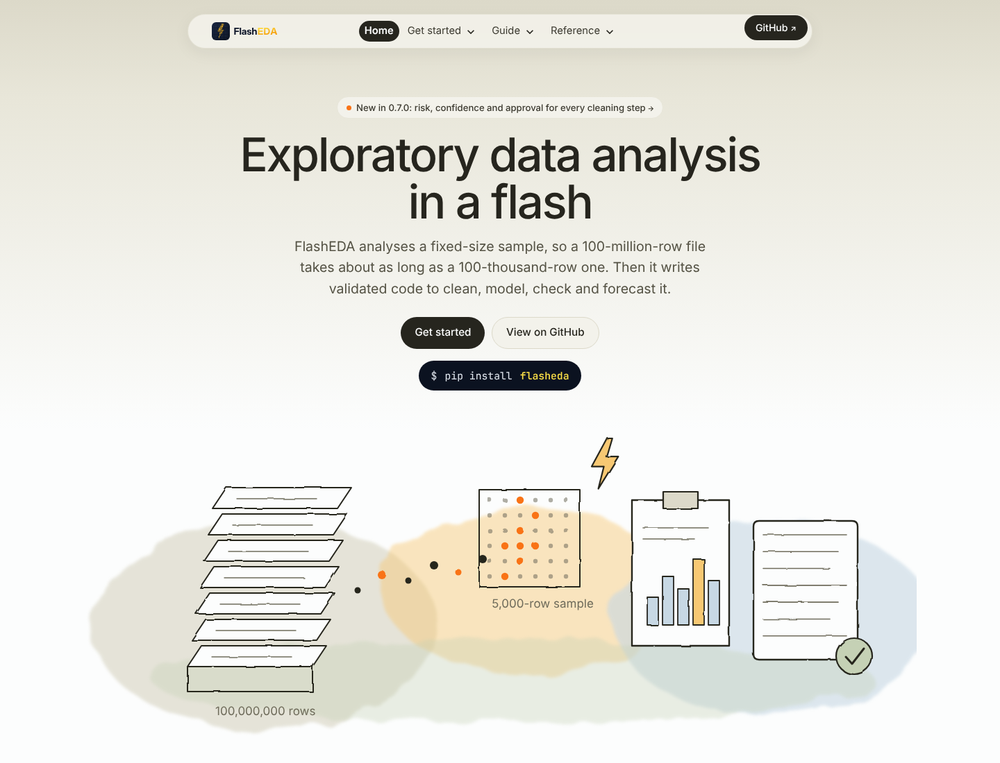
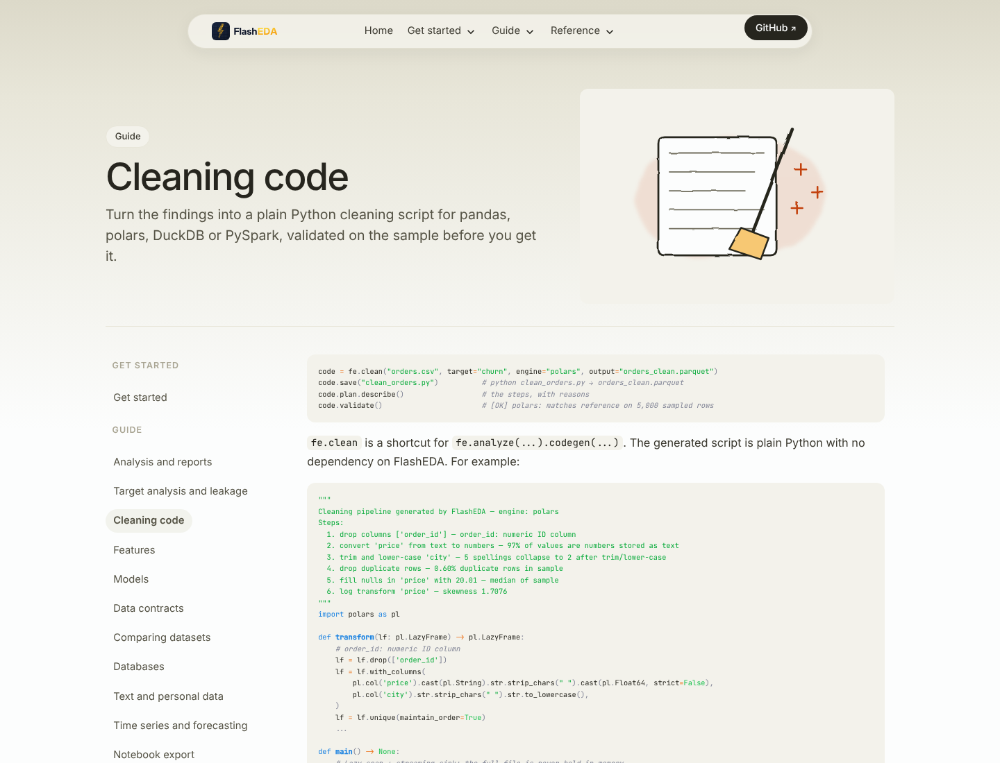

<p align="center">
  
</p>

# FlashEDA Documentation

The documentation website for **[FlashEDA](https://github.com/sjapanjots/Flash-EDA)**, the Python package for
fixed-time exploratory data analysis and validated cleaning, modelling, data-check and forecast code.

Built with [Streamlit](https://streamlit.io) and designed for deployment on Streamlit Community Cloud.



## What's inside

- **Home page**: hero, how FlashEDA works (sample → analyse → plan → write → validate), feature cards, performance numbers and engines.
- **Get started**: installation, optional extras and quick start.
- **Guide** (11 pages): analysis and reports, target analysis and leakage, cleaning code, features, models, data contracts, comparing datasets, databases, text and personal data, time series and forecasting, notebook export.
- **Reference**: engines and scaling, API reference, performance and limitations, changelog, contributing.



## Design

The visual language takes inspiration from [getnudge.info](https://getnudge.info/): warm sand neutrals, warm-ink text, Inter at weight 500 with tight tracking, a floating pill navigation bar, pill tags and buttons, 12 px sand panels, a large statement section, a huge footer wordmark and ink-and-watercolour illustrations. FlashEDA's own navy tile and amber bolt are the brand accents.

All illustrations are original, drawn as SVG in `docs_site/illustrations.py` (ink lines with a slight hand-drawn wobble over soft watercolour washes).

## Project structure

```
.
├── app.py                    # entry point: theme, logo, top navigation
├── docs_site/
│   ├── pages.py              # page registry, home page, docs page renderer
│   ├── theme.py              # global CSS, buttons, pills, footer
│   └── illustrations.py      # original SVG illustrations
├── content/                  # one Markdown file per docs page (generated)
├── scripts/sync_content.py   # regenerate content/ from the Flash-EDA repo
├── assets/logo/              # FlashEDA logo files (from the package repo)
├── .streamlit/config.toml    # theme: colours, Inter, JetBrains Mono, radii
└── requirements.txt
```

## Run locally

```bash
pip install -r requirements.txt
streamlit run app.py
```

## Deploy on Streamlit Community Cloud

1. Go to [share.streamlit.io](https://share.streamlit.io) and click **Create app**.
2. Choose this repository, branch `main` and main file path `app.py`.
3. Click **Deploy**. No secrets or extra settings are needed.

## Updating the content

The pages are generated from FlashEDA's README, CHANGELOG and CONTRIBUTING files, so the docs match the package exactly:

```bash
git clone https://github.com/sjapanjots/Flash-EDA ../Flash-EDA
python scripts/sync_content.py ../Flash-EDA
```

Page titles, sections, short introductions and illustrations are set in `docs_site/pages.py`.

---

Designed & developed by **Japanjot Singh**.
